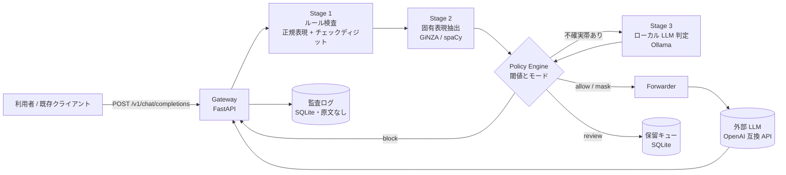

# llm-guard-gateway

**An input-guarding proxy for LLM APIs.** Every prompt is inspected in three stages (regex rules → Japanese NER → local-LLM judgement) and then masked, blocked or held for review before anything reaches the external model. OpenAI-compatible, so existing clients only change their base URL. Ships with a synthetic-data evaluation harness that reports miss rate, over-block rate and latency per configuration.

[](https://github.com/ikkeiman/llm-guard-gateway/actions/workflows/ci.yml)

## これは何か

企業で生成AIを使うときの「送る前に止める」仕組みです。利用者のプロンプトを受け取り、個人情報・機微情報を3段階で検査し、問題がなければ外部 LLM（OpenAI 互換 API）へ転送して応答を返します。検出したときは設定に応じて、**マスクして送る**／**拒否する**／**保留して人の確認に回す**のいずれかを行います。

約100名規模の組織で全職員向けの生成AI基盤を設計・開発した経験をもとに、その中核である「送る前に止める」仕組みを、一般的な個人情報を対象に一から作り直したものです。会社固有のルールやコードは含みません。

解決したいこと:

- **禁止だけでは現場が使わなくなる。** 個人情報が混ざった文でも、その部分だけ伏せて使えるようにしたい（既定は mask）
- **検出を1つの手法に頼ると穴が出る。** 形式が決まったものはルールで速く確実に、文中の氏名は固有表現抽出で、判断がつかないものだけローカル LLM に聞く
- **「見逃し」と「止めすぎ」はトレードオフで、許容ラインは業務ごとに違う。** だから閾値とモードを設定で変え、その影響を同じデータで測れるようにした
- **ガードのログが個人情報の保管場所になってはいけない。** 監査ログには原文を残さない

## 構成



- 各段階は同じインターフェース `Detector.detect(text) -> list[Finding]` を実装し、段階の ON/OFF は `policy.yaml` だけで切り替えられる
- `Finding` は種類（`my_number | phone | postal_address | email | person_name | credit_card | bank_account | other_sensitive`）、位置、confidence、どの段階が出したか
- Policy Engine は confidence を3帯に分ける。**確定**（0.90 以上）はモードどおりに扱う。**不確実**（0.40〜0.90）は Stage 3 に回す。それ未満は無視する
- **早期終了**: Stage 1 の時点で block が確定したら、以降の段階は走らせない
- Stage 3 は既定で「不確実帯の検出があるときだけ」呼ぶ（`always | on_uncertain | off`）。文と一緒に Stage 1/2 の候補を渡し、「この候補は個人情報として扱うべきか」を聞く。全件 LLM 判定は遅く不安定なため

## 動かし方

### docker compose（gateway + Ollama + 転送先のモック）

```bash
git clone https://github.com/ikkeiman/llm-guard-gateway.git
cd llm-guard-gateway
docker compose up -d --build
docker compose exec ollama ollama pull qwen2.5:7b-instruct   # 初回だけ。数 GB
curl -s localhost:8000/healthz
```

転送先は既定で同梱のモック（最後の user メッセージをそのまま返す）に向いています。実際の OpenAI 互換 API に送るときは `.env.example` を `.env` にコピーして `OPENAI_BASE_URL` と `OPENAI_API_KEY` を入れ、`docker-compose.yml` の gateway から `OPENAI_BASE_URL` の行を消してください。`.env` はコミットしないでください。

### ローカル（uv。Docker なしで動く）

[uv](https://docs.astral.sh/uv/) が入っていれば、Docker が無くても動きます。Python は `.python-version` の 3.12 を uv が自動で用意します（3.14 以降は依存のバイナリが無くビルドに失敗するため `requires-python` で除外しています）。ターミナルを2つ使います。

macOS / Linux:

```bash
uv sync --all-extras --dev        # GiNZA 込み。Stage 2 を使わないなら --all-extras を外す
uv run python -m llm_guard.mock_llm                   # ターミナル1: 転送先のモック（:8001）
OPENAI_BASE_URL=http://127.0.0.1:8001/v1 uv run uvicorn llm_guard.main:app --port 8000   # ターミナル2
```

Windows（PowerShell）:

```powershell
uv sync --all-extras --dev
uv run python -m llm_guard.mock_llm                   # ターミナル1
$env:OPENAI_BASE_URL = "http://127.0.0.1:8001/v1"; uv run uvicorn llm_guard.main:app --port 8000   # ターミナル2
```

Windows の `curl.exe` では JSON の引用符をエスケープする必要があるため、動作確認は http://localhost:8000/docs の画面（FastAPI が自動生成）から送るのが簡単です。

Stage 3 を使うには別途 [Ollama](https://ollama.com/) を起動し、`ollama pull qwen2.5:7b-instruct` しておきます。疎通と1件あたりの所要時間は `uv run python -m llm_guard.judge_check "山田太郎に資料を送る"` で確認できます。Ollama に届かないときは Stage 3 を飛ばし、不確実帯の検出は `uncertain_without_judge`（既定 mask）で扱います。

### 最初の1リクエスト

```bash
# 検査だけ（判定の中身を見る）
curl -s localhost:8000/v1/inspect -H 'content-type: application/json' \
  -d '{"text":"山田太郎さんの連絡先は 090-1234-5678 です"}'
```

```json
{
  "decision": "mask",
  "findings": [
    {"kind": "phone", "start": 12, "end": 25, "confidence": 0.95, "stage": "rules", "rule": "phone_mobile"},
    {"kind": "person_name", "start": 0, "end": 4, "confidence": 0.92, "stage": "ner", "rule": "ginza:Person"}
  ],
  "stages_run": ["rules", "ner"],
  "timings_ms": {"rules": 0.12, "ner": 17.45},
  "masked_text": "<PERSON_NAME_1>さんの連絡先は <PHONE_1> です"
}
```

```bash
# OpenAI 互換。既存クライアントの base_url を向けるだけ
curl -s -i localhost:8000/v1/chat/completions -H 'content-type: application/json' \
  -d '{"model":"gpt-4o-mini","messages":[{"role":"user","content":"山田太郎さん（090-1234-5678）に明日の予定を伝える文面を作って"}]}'
```

応答ヘッダに `x-guard-decision: mask` と `x-guard-stages: rules,ner` が付き、外部 LLM には `<PERSON_NAME_1>さん（<PHONE_1>）に…` が送られます。同じ値には同じ番号が振られるので、LLM は「誰が」を区別したまま文脈を扱えます。

| メソッド | パス | 役割 |
|---|---|---|
| POST | `/v1/chat/completions` | OpenAI 互換。検査 → 転送 → 応答。block は 403、review は 202 と `review_id` |
| POST | `/v1/inspect` | 検査のみ。判定と `Finding` 一覧（デバッグ・評価用） |
| GET | `/v1/review` | 保留キューの一覧（原文は出ない） |
| POST | `/v1/review/{id}` | `{"action":"approve","send":"masked"}` または `{"action":"reject"}` |
| GET | `/healthz` | 各段階の準備状態。GiNZA のロード、Ollama への到達可否 |

## 設計判断

**なぜ3段階か。** ルールは速く（1件 0.1ms 未満）確実だが、形式が決まったものしか拾えない。固有表現抽出は文中の氏名を拾えるが、会社名や地名を人名と取る誤検知がある。LLM 判定は柔軟だが遅く（数秒）、出力が安定しない。性格の違うものを重ね、**前の段階で判断がつかなかったものだけ**次に渡すことで、速さと網羅性を両立させています。評価結果の表で、段階を足すと見逃しが減り止めすぎが増える様子がそのまま見えます。

**見逃しと止めすぎのどちらに倒すか。** 正解は業務ごとに違います。問い合わせ対応なら止めすぎると使われなくなり、人事情報を扱う部署なら見逃しは許されない。だから `policy.yaml` の `mode` と閾値、種類ごとの `min_action` で変えられるようにし、評価ハーネスで同じデータに対する影響を測れるようにしました。既定は mask で、個人番号とカード番号だけは mode に関わらず block です。

**原文をログに残さない理由。** 監査ログに原文を残すと、ログ自体が個人情報の保管場所になり、守る対象が増えます。残すのは決定・走った段階・検出の種類と位置と confidence・所要時間だけです。原文を含む検出をログに渡すとアサーションで止まるようにしています。保留キューだけは承認のために原文を持ちますが、解決した時点で消します。

**Stage 3 の「不在」と「失敗」を分ける。** Ollama を立てていない環境では Stage 3 を飛ばして `uncertain_without_judge` に従い、Ollama に届いたのに JSON が壊れた・タイムアウトしたときだけ `on_judge_error`（既定 review）にします。前者まで review にすると、モデルを用意していない環境で何もできなくなるためです。

**Stage 3 には「文」ではなく「候補」を渡す。** 最初は文だけを渡して「個人情報が含まれるか」と聞いていました。すると LLM は、氏名の無い住所や文脈のない 12 桁の番号を「特定の個人を識別できない」と答え、ルールが見つけた検出を解放してしまい、見逃しが 23.6% まで増えました。一般論としては LLM の答えも間違いではなく、問題は役割の与え方でした。Stage 3 の役割は「Stage 1/2 が見つけた候補が、文脈上、本当に個人情報か」を判断することなので、候補の種類と該当箇所をプロンプトに渡し、住所や番号は氏名が無くても該当すると明記しました。さらに、検査数字や Luhn で検証済みの番号は、機械的な判定の方が LLM より信頼できるので、LLM が「違う」と言っても維持します（`kinds.<kind>.judge_can_release: false`）。

**JSON モードには出力長の上限を付ける。** GPU で動いているのに Stage 3 が 30 秒でタイムアウトする事象がありました。Ollama の計測値を見ると、プロンプト処理も生成も 1 秒未満で終わっているのに応答が返らない。JSON モードでモデルが停止トークンを出さず空白を生成し続ける挙動で、`num_predict` に上限を付けて解決しました。返す JSON は 100 トークンに満たないので 160 で十分です。この切り分けのために `python -m llm_guard.judge_check` を用意しています。

**マスクは番号付きプレースホルダ。** `<PERSON_NAME_1>` のように同じ値には同じ番号を振り、複数メッセージにまたがっても対応を共有します。応答の中のプレースホルダを元に戻す逆変換は既定オフです（オンにすると利用者には元の名前で返りますが、外部 LLM には渡っていません）。

## 評価結果

合成データ 500 件（陽性 250 / 陰性 250、seed 固定）に対する結果です。計測環境は Windows 11、Ryzen 5 3600、メモリ 64 GB、Stage 3 は RTX 3060 Ti（8 GB）上の Ollama で `qwen2.5:7b-instruct`（Q4_K_M）。詳細と種類別の表は [`eval/results/latest.md`](eval/results/latest.md) にあります。

| 設定 | 見逃し率 ↓ | 止めすぎ率 ↓ | p50 | p95 | Stage 3 の呼び出し |
|---|---|---|---|---|---|
| rules のみ | 7.6% | 0.4% | 0.05 ms | 0.13 ms | 0 回 |
| rules + ner | 0.0% | 2.0% | 17.8 ms | 23.8 ms | 0 回 |
| **rules + ner + llm(on_uncertain)**（既定） | **2.8%** | **0.0%** | 22.3 ms | 512 ms | 217 回 |
| rules + ner + llm(always) | 2.8% | 10.0% | 409 ms | 509 ms | 500 回 |

読み取れること:

- **rules のみ**の見逃しは、すべて文中に氏名だけが出てくる文（「訪問先: 坂本亮介」）。形式のないものはルールでは拾えない
- **ner を足す**と見逃しは 0 になるが、止めすぎが増える。最初は 11.6% あり、「長野支店」「東京都内」を人名と取っていた。組織・場所の語尾で除外して 2.0% まで下げた。残りの誤検知（会社名の中の姓など）が Stage 3 の出番
- **Stage 3 を不確実帯だけに使う**と止めすぎは 0 になる。代わりに見逃しが 2.8% 出る。内訳は住所 7 件で、LLM が「番地までの住所」を個人情報でないと判断したもの。氏名・電話・メール・個人番号・カード・口座は 100%
- **全件を Stage 3 に通す**と、見逃しは変わらないのに止めすぎが 10% に増え、p50 は 20 倍になる。増えた分は、LLM が位置を特定できない「機微」を報告して review に回ったもの。不確実帯だけに絞る既定が、精度でも速度でも正しいことが分かる
- Stage 1 は 0.1 ms 未満、Stage 2 は CPU で 18 ms 前後、Stage 3 は GPU で 1 件 400 ms 前後。全件に通すと p50 がそのまま 400 ms に張り付く

Stage 3 の最初の実測は、見逃し 23.6%（住所の再現率 35.8%、個人番号 77.8%）でした。「この文に個人情報があるか」と聞くと、氏名が無い住所や文脈のない 12 桁の番号を「個人を識別できない」と答えるためです。聞き方を「Stage 1/2 が見つけたこの候補は個人情報として扱うべきか」に変え、検査数字・Luhn で検証済みの番号は LLM に解放させない（`judge_can_release: false`）ようにして 2.8% になりました。経緯は [設計判断](#設計判断) に書いています。

限界:

- **合成データでの参考値です。** 個人情報の形式は生成テンプレートと検出ルールが同じ知識から作られているので、rules の再現率 100% は実データでは成り立ちません。実データには表記ゆれ、OCR の誤り、伏せ字の中途半端な番号などがあります
- Stage 3 の結果はモデルとプロンプトに依存します。別のモデルでは数字が変わります
- 種類別の再現率・適合率は文書単位（その種類が文書に「ある」と判定したか）で、スパンの位置の一致までは見ていません

```bash
uv run python eval/generate_dataset.py --n 500 --seed 42     # データを作り直す
uv run python eval/run_eval.py                               # 全設定で計測し eval/results/latest.md を更新
```

## 設定リファレンス

### `config/policy.yaml`

```yaml
mode: mask                      # 検出時の既定: mask | block | review
stages:
  rules: on
  ner: on
  llm_judge: on_uncertain       # always | on_uncertain | off
thresholds:
  block_at: 0.90                # これ以上は確定検出
  uncertain_low: 0.40           # この帯（low 以上 high 未満）は Stage 3 へ
  uncertain_high: 0.90
kinds:                                 # 種類ごとの上書き
  my_number: { min_action: block, judge_can_release: false }    # 最低 block。Stage 3 が「違う」と言っても維持
  credit_card: { min_action: block, judge_can_release: false }
on_judge_error: review          # Stage 3 が JSON を返せない・タイムアウト
on_judge_only_detection: review # Stage 3 だけが機微と判断し、マスクする位置が無い
uncertain_without_judge: mask   # Stage 3 が off か不在のときの不確実帯の扱い
llm_judge:
  model: qwen2.5:7b-instruct
  timeout_seconds: 30           # CPU 実行では 1 件 10〜30 秒かかることがある
  max_retries: 1
masking:
  restore_in_response: false
```

### `config/rules.yaml`

Stage 1 の定義。1ルールは正規表現・検証関数（`my_number_check_digit` / `luhn` / `jp_phone_digits`）・confidence・文脈キーワードからなります。たとえば個人番号は、チェックディジットが合えば 0.70、近くに「マイナンバー」「個人番号」があれば 0.98 です。全角数字や全角ハイフンは、位置を変えずに半角へ寄せてから照合します。

### 環境変数（`.env.example`）

| 変数 | 意味 |
|---|---|
| `OPENAI_BASE_URL` / `OPENAI_API_KEY` / `OPENAI_MODEL` | 転送先。`OPENAI_MODEL` を入れるとクライアント指定の model を上書き |
| `OLLAMA_BASE_URL` / `OLLAMA_MODEL` | Stage 3。`OLLAMA_MODEL` は policy.yaml より優先 |
| `GUARD_POLICY_PATH` / `GUARD_RULES_PATH` / `GUARD_DATA_DIR` | 設定ファイルと SQLite の場所 |

## やっていないこと・制約

- **本番運用はしていません。** 個人の検証用の実装で、認証・レート制限・TLS 終端などはありません。前段のリバースプロキシや社内ネットワークで守る前提です
- **評価は合成データ**で、モデルの精度は参考値です
- **日本語のみ。** ルールは日本の個人情報の形式、固有表現抽出は日本語モデルです
- **転送先は OpenAI 互換 API のみ。** Amazon Bedrock など別形式の API には対応していません
- **`stream: true` は未対応**（400 を返します）。応答の検査・復元のために全文を受け取る設計です
- Stage 3 は Ollama の `/api/chat` 専用です。評価は `qwen2.5:7b-instruct`（Q4_K_M）だけで行い、他のモデルでは試していません
- 画像・ファイルなど文字列以外の入力は検査しません（`content` 配列の `text` パーツだけを見ます）
- Dockerfile と docker-compose.yml は、この README を書いた環境では Docker デーモンが無く動作確認できていません。ローカルの `uv` での起動は Linux と Windows 11 で確認済みです（Windows では Stage 1・2 が動き、`/v1/inspect` が期待どおり mask を返すことを確認）。テスト（72 件）と評価は Linux で実行しました

## 開発

```bash
uv sync --all-extras --dev
uv run ruff check . && uv run ruff format --check .
uv run pytest -q
```

CI（GitHub Actions）は ruff、pytest、合成データでの評価（rules / rules+ner）を実行します。

## ライセンス

MIT
